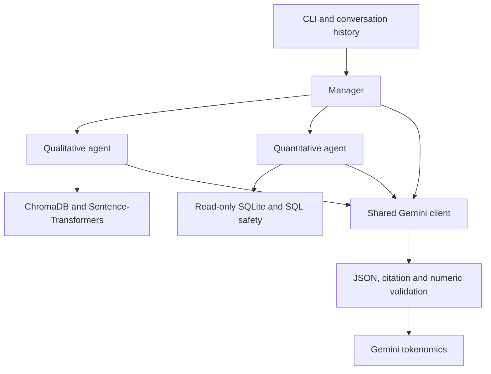

# Unit 2 Capstone: Multi-Agent RAG System with Google Gemini

A Python 3.11 CLI application that answers questions about company policies
(qualitative) and business data (quantitative) using a multi-agent architecture.
All data is entirely fictional and created for educational purposes only.

---

## Gemini migration

The existing Gold implementation uses Google Gemini for every application LLM
call through `llm_client.invoke()`. The OpenAI Python SDK is only the client for
Google's OpenAI-compatible endpoint; Google serves the model and receives requests.
`bedrock_client.py` is a deprecated Gemini import shim with no AWS calls.

Default: `gemini-3.6-flash`. Override with `GEMINI_MODEL`.
HTTP 429, 503 and SDK timeout errors are retried with at most three total requests and
backoff waits of 1 and 2 seconds. Two quota errors select the approved
`gemini-3.5-flash-lite` fallback. A 503 retries the same selected model. SDK
retries are disabled. Other API failures fail immediately
with sanitized diagnostics. Request timeout is 90 seconds per attempt.

The shared `temperature` argument is retained for existing callers but is not
sent to Google: Gemini 3.6 Flash and 3.5 Flash-Lite ignore deprecated sampling
parameters. See https://ai.google.dev/gemini-api/docs/generate-content/whats-new-gemini-3.6.

System instructions and ordered user/assistant history are preserved. Gemini
`stop` is normalized to `end_turn` and `length` to `max_tokens` for existing
validators. `provider_finish_reason` always retains the original provider value.
Safety blocks, missing content, missing finish reasons, and truncation are
explicitly marked invalid; partial truncated text and returned usage are retained.
Missing usage remains `null`, including affected query totals. Completion token
counts are used as returned. The compatibility endpoint excludes thinking from
completion tokens and includes it in total tokens. Thinking and billable output
are derived from returned totals, labelled as derived, and counted once.

Historical Bedrock logs remain byte-for-byte unchanged:
`tokenomics_log.jsonl`, `evidence/live_calls.jsonl`,
`evidence/query_results.jsonl`, and the two v2 JSONL files.
They support the historical human-review examples below, not Gemini results.
New accounting defaults to `tokenomics_gemini_log.jsonl`; new evidence goes to
`evidence/gemini/`. All ten distinct questions now have successful results across
the preserved ten-query batch and the separate two-query retry.
See `MIGRATION_REPORT.md` for actual test results and changed files.

## Trust-but-Verify

Verified from the project author's saved Gemini evidence on 2026-10-08:

| Check | Result |
|---|---|
| Offline suite on the author's Mac | **236 passed in 1.97s** |
| Ten-query run `20261008T174810Z-cb8972bf` | **9/10 passed**; follow-up failed with HTTP 503 |
| Isolated same-session pair `20261008T180319Z-0146155d` | **2/2 passed** |
| Unique real questions completed successfully across both runs | **10** |
| Captured SQL result sets checked against the committed SQLite data | **6/6 match** |
| Citation IDs and excerpts checked against retrieved chunks and source policies | **16/16 match** |
| Same-session history | Combined answer's `history_after` equals follow-up's `history_before`; the prior answer is present |
| Successful model in both verified runs | `gemini-3.5-flash-lite` |

The ten-question run includes supported policy, quantitative and combined
questions, plus legitimate refusals for unsupported policy and destructive
requests. It was not a single 10/10 run: the follow-up succeeded in a separately
saved two-query retry using one Manager instance. All earlier errors remain
visible. The simple `gemini-3.6-flash` smoke also succeeded, but the complete
agent evidence uses the instructor-approved Flash-Lite model.

### Verified token accounting

Totals below cover returned responses from these two runs only. They exclude
the separate smoke and earlier failed batches. Failed API attempts have unknown
usage and are preserved without manufactured token counts or actual charges.

| Run | Returned responses | Input | Answer | Derived thinking | Provider total | Hypothetical paid estimate |
|---|---:|---:|---:|---:|---:|---:|
| Ten questions, including the failed follow-up | 23 | 21,312 | 3,545 | 0 | 24,857 | $0.01525610 |
| Successful combined + follow-up pair | 10 | 6,718 | 1,407 | 0 | 8,125 | $0.00553290 |
| Combined returned-response totals | 33 | 28,030 | 4,952 | 0 | 32,982 | $0.02078900 |

All 33 returned calls ended with provider `stop` and passed their automated
validation. The first run contains one additional API-failure outcome after
three 503 attempts, with no returned usage and no fabricated paid cost. It has
nine query summaries because that follow-up failed before any returned call;
the successful pair has two summaries. Each summary reconciles to its call
records. Billing tier remains `unknown`; these paid estimates are hypothetical,
and conditional free-tier estimates are not proof of an actual charge.

### Human-review provenance

The project author previously confirmed these decisions: accept PR requirements
once checked against policy; accept regional revenue after independent arithmetic;
accept the Sales score but clarify policy applicability. The same confirmed
review standard is applied below to the newly verified Gemini outputs. Raw model
answers and evidence are preserved; the human clarification is separate.

### Gemini review 1 — PR approval requirements

**Query**: What are the requirements for PR approval in the code review policy?

**Evidence**: `evidence/gemini/runs/20261008T174810Z-cb8972bf/query_results.jsonl`, `3d639d25b86f`.

**Raw Gemini output (verbatim)**:

> According to the code review policy, the requirements for PR approval are:
> - Every PR must have at least two approvals before merging to main or a release branch.
> - At least one reviewer must be a domain owner (maintainer of the affected subsystem).
> - PRs touching security-critical code (auth, payments, cryptography, secrets handling) require an additional approval from a member of the Security Review Board.
> - The author may not approve their own PR.
> - Reviews from automated bots do not count toward the human-reviewer minimum.

**Validation and independent check**: valid=True, no errors or warnings.
All five approval rules match `data/documents/code_review_policy.md`. This
Gemini answer has **five citations**, all to `code_review_policy.md::chunk_2`;
the chunk IDs and verbatim excerpts match the captured retrieved context and
source document.

**Decision carried forward from the author's confirmed review**: ACCEPT.
The claims satisfy the same policy checks as the historical example.

### Gemini review 2 — Regional revenue

**Query**: What is the total revenue by region for 2024?

**Evidence**: `evidence/gemini/runs/20261008T174810Z-cb8972bf/query_results.jsonl`, `5b69165e7815`.

**Raw Gemini output (verbatim)**:

> In 2024, the West region generated the highest revenue at 501,967.15 USD, followed by EMEA with 440,725.04 USD. East generated 293,775.07 USD, North generated 286,255.82 USD, and South generated the lowest revenue at 190,605.30 USD.

**Generated SQL**:

```sql
SELECT region, ROUND(SUM(amount), 2) AS revenue FROM sales WHERE strftime('%Y', sale_date) = '2024' GROUP BY region
```

**Validation and independent check**: valid=True, no errors or warnings.
The saved SQL returns the exact five saved region rows in the committed SQLite
database. Independent arithmetic gives
501,967.15 + 440,725.04 + 293,775.07 + 286,255.82 + 190,605.30
= **$1,713,328.38**. This total is a reviewer cross-check, not an added claim in
the raw Gemini answer.

**Decision carried forward from the author's confirmed review**: ACCEPT after
independent database and arithmetic verification. The original failed SQL
response is retained in `evidence/gemini/live_calls.jsonl`; its provider finish
reason is `length`, normalized to `max_tokens`, confirming truncation in that
Gemini run. This is separate from the historical Bedrock code-fence failure.

### Gemini review 3 — Satisfaction follow-up: clarify applicability

**Query**: Which department scored lowest, and what does the policy recommend for managers in that department?

**Evidence**: `evidence/gemini/runs/20261008T180319Z-0146155d/query_results.jsonl`, `5921b452e84f`. The preceding combined answer is `6c5d5783f718` in the same file.

**Raw Gemini output (verbatim)**:

> The data shows that the department with the lowest average employee satisfaction score is Sales. According to company policy, managers whose teams score below the 25th percentile for two consecutive quarters must complete a People Manager Coaching programme consisting of six sessions over twelve weeks.

**Generated follow-up SQL**:

```sql
SELECT department FROM employees WHERE status = 'active' GROUP BY department ORDER BY AVG(satisfaction_score) ASC LIMIT 1
```

**Validation and independent check**: valid=True, no errors or warnings.
The follow-up SQL returns `Sales`; the preceding combined query and independent
SQL verification establish its average score as **6.53**, the lowest among
active employees' departments. The follow-up includes the prior combined answer
in the same Manager session. Its coaching-rule citation matches HR-005.

**Decision carried forward from the author's confirmed review**: ACCEPT the
ranking and score; CLARIFY the interpretation. The raw output states a true
conditional rule, but it does not establish that Sales meets that rule. A single
average does not prove two consecutive quarters below a specified percentile,
manager-effectiveness results, or an eNPS threshold.

**Human clarification (separate from raw Gemini output)**:

> Sales has the lowest average satisfaction score among active employees, 6.53.
> Under HR-005, the department head should review survey results with their HR
> Business Partner and document at least two actions with owners and dates.
> The available data cannot establish whether Sales meets the two-quarter,
> below-25th-percentile coaching threshold or any eNPS escalation threshold.
> Coaching remains conditional on those additional facts.

This example shows the limit of automated checks: verified SQL values and
source citations do not determine whether a conditional policy applies.
Some captured policy excerpts begin mid-word because the retrieved chunk begins
mid-word. Those fragments pass substring checks, but human readers should consult
the complete policy for full context.

---

## Architecture



---

## Dataset (Fictional — Educational Use Only)

All data represents the entirely fictional company "Acme Corp". No real persons,
companies, or events are depicted.

### Policy documents (`data/documents/`)

| File | Policy ID | Topic |
|------|-----------|-------|
| `security_policy.md` | SEC-001 | Passwords, MFA, data classification, incident response |
| `code_review_policy.md` | ENG-002 | PR size, approvals, review checklist, automated checks |
| `customer_complaints_policy.md` | CS-003 | Intake, SLAs, escalation procedures |
| `customer_success_policy.md` | CS-004 | Segmentation, onboarding, health scoring, QBRs |
| `employee_satisfaction_policy.md` | HR-005 | Pulse surveys, eNPS, manager accountability |

### SQLite database (`data/database.sqlite`)

| Table | Rows | Key columns |
|-------|------|-------------|
| `customers` | 50 | id, name, region, tier, status, signup_date, mrr, industry |
| `sales` | 375 | id, customer_id, amount, sale_date, region, rep_name, product |
| `employees` | 40 | id, name, department, region, hire_date, annual_salary, satisfaction_score, status |

Seed script: `data/seed_database.py` (fixed random seed 42, idempotent)

---

## Gemini Setup and Quick Start

Python 3.11 or newer. Use a Gemini API key from Google AI Studio.
Google compatibility documentation:
https://ai.google.dev/gemini-api/docs/openai

```bash
python -m venv .venv
source .venv/bin/activate      # Windows: .venv\Scripts\activate
pip install -r requirements.txt
cp .env.example .env
```

Edit `.env` locally. Replace `GEMINI_API_KEY` with your key and `GEMINI_MODEL`
with `gemini-3.6-flash`, or leave the model blank for that default. Never paste
credentials into chat, logs, documentation, or commits. `.env.example` contains
placeholders only and `.env` is gitignored.

Optional `GEMINI_BILLING_TIER`: `free`, `paid`, or `unknown` (default).
Only set `free` after checking your API project's actual billing tier.
Optional `GEMINI_TOKENOMICS_LOG` selects a new Gemini log file. Historical
Bedrock log paths are rejected; old `TOKENOMICS_LOG` and Claude rate overrides
are ignored.

Run the offline tests, then one smoke query:

```bash
pytest tests/ -q
python smoke_test.py
```

After the smoke, capture the full application evidence:

```bash
python evidence/run_live_checks.py
```

When selecting the instructor-approved Flash-Lite model explicitly for a run:

```bash
GEMINI_MODEL=gemini-3.5-flash-lite python evidence/run_live_checks.py
```

To retry only the combined question and follow-up, keeping the original run:

```bash
GEMINI_MODEL=gemini-3.5-flash-lite python evidence/run_live_checks.py --followup-pair
```

The pair uses one Manager instance. If its combined query does not pass, the
follow-up is skipped and recorded as a failure rather than tested without the
required context. Each run has an independent ledger under
`evidence/gemini/runs/<run-id>/`.
Generation budgets are 4096 tokens for classification/SQL and 8192 for policy
answers, interpretation and synthesis, because Gemini's limit includes thinking
plus answer tokens. Truncated output still fails validation before SQL execution.

The smoke test passes only with nonempty complete text and actual usage metadata.
It writes honest success/failure evidence to `evidence/gemini/smoke_test.jsonl`.
Missing credentials produce a failure without sending an API request.
For normal application use after the migration review:

```bash
python data/seed_database.py
python ingest.py --reset
python main.py
```

---

## Installation

Python 3.11 required.

```bash
python -m venv .venv
source .venv/bin/activate      # Windows: .venv\Scripts\activate
pip install -r requirements.txt
```

---

## Data Seeding

```bash
python data/seed_database.py                    # default: data/database.sqlite
python data/seed_database.py --db /tmp/test.db  # alternate path for testing
```

Creates the target file with 50 customers, 375 sales, 40 employees.
The script is idempotent (drop-and-recreate). Fixed random seed 42 ensures
identical output on every run.

---

## Document Ingestion

```bash
python ingest.py                                          # default: chroma_store/
python ingest.py --reset                                  # delete and rebuild
python ingest.py --chroma-path /tmp/test_chroma --reset  # alternate path for testing
```

Chunks the 5 policy documents and stores them in the target ChromaDB directory
(cosine similarity, 39 chunks total).

---

## Running the CLI

**Interactive mode:**
```bash
python main.py
```
Type `exit` or `quit` to stop. Type `reset` to clear conversation history.

**Single-query mode:**
```bash
python main.py "What is the password policy?"
```

---

## Running Tests

```bash
pytest tests/ -v
```

The complete suite is offline and uses mocked provider responses, a fake SDK
HTTP transport, and temporary/in-memory databases. It covers the existing
routing, history, SQL safety, JSON parsing, citation and numeric validations,
plus Gemini client response mapping, API failures, quota fallback, pricing,
missing usage and per-query totals. Actual counts are in `MIGRATION_REPORT.md`.
The corrected suite has **236 passing tests**. The qualitative tests include
the real tokenomics logger for successful answers and retries, so logger
interface errors are tested without live credentials or retrieval downloads.

---

## Supported Questions

### Qualitative (policy/documentation)
- "What is the security policy for passwords?"
- "What are the PR approval criteria?"
- "How are customer complaints escalated?"
- "What is the employee onboarding process?"

### Quantitative (data/metrics)
- "What was total revenue by region in 2024?"
- "How many employees are in each department?"
- "What is the customer churn rate?"
- "What is the average employee satisfaction score by department?"

### Combined (both sources)
- "What does the customer success policy say about at-risk customers, and how many customers have churned?"
- "What is the remote work policy and how many employees are currently active?"

### Out of scope (refused)
- General world knowledge ("What is the capital of France?")
- Requests to modify data ("Delete all customer records")

---

## Metric Definitions

These definitions are built into the SQL-generation prompt to ensure consistent
query construction:

| Metric | Definition |
|--------|-----------|
| Revenue | `SUM(sales.amount)` for a period or grouping |
| Churn rate (%) | `COUNT(status='churned') * 100.0 / COUNT(*) FROM customers` |
| Active customers | `WHERE status = 'active'` |
| MRR | `customers.mrr` column (monthly recurring revenue per customer) |
| Employee satisfaction | `AVG(satisfaction_score) WHERE status='active'` (scale 1–10) |
| Average salary | `AVG(annual_salary)` in USD per year |

---

## Conversation History

The Manager maintains a bounded session history of the last 10 turns
(`MAX_HISTORY_TURNS = 10` in `agents/manager.py`). History is passed as
context to all agents on each call so follow-up questions can refer to
earlier answers.

- History persists for the lifetime of one `python main.py` session.
- Type `reset` in the CLI to clear history.
- History contains only validated, non-refused answers. Failed responses
  (classification errors, unsupported queries) are not added.
- When a query fails mid-session (e.g. SQL generation error), the failed
  exchange is not stored in history but does not automatically clean up
  intermediate message context from the current session. Type `reset` to
  start a fresh session if you encounter repeated SQL generation failures.

---

## Validation Design

Every LLM response is validated before use. Validation failures trigger
a retry (up to 2 total calls per step); if retries are exhausted the query
is refused rather than returning an unvalidated answer.

### Qualitative responses (`validate_qualitative_response`)
- `stop_reason` must be `"end_turn"` (not truncated)
- Required fields: `answer`, `citations`, `refused`
- Non-refused answers must include at least one citation
- Each citation `chunk_id` must be present in the retrieved set
- Each citation `excerpt` is checked as a substring of the retrieved chunk text
  (whitespace-normalised). An excerpt not found in its chunk is a hard error.

**Known limitation**: Excerpt substring matching does not prove every claim in the
answer is supported — it only confirms the quoted text appeared in the retrieved chunk.

### SQL validation (`validate_sql`) — three layers
1. **Regex pre-filter**: blocks DML keywords, comment markers
2. **Quote-aware statement counter**: rejects multi-statement payloads
3. **SQLite authorizer on in-memory schema**: catches unknown tables, columns,
   and functions during SQL PREPARE (before any data is touched)

Additionally: all SQL is executed on a read-only URI connection
(`?mode=ro`) with a runtime authorizer as defense-in-depth.

### Interpretation responses (`validate_quantitative_interpretation`)
- `stop_reason` check
- Structured `numeric_claims` with `{value, row_index, column, unit}`:
  each claim is validated against `result_rows[row_index][column]` using
  metric-appropriate precision:
  - USD: ±$0.01  |  percent: ±0.1  |  count: exact  |  score: ±0.05
- `derived_claims` with `{value, formula, unit}` computed in Python.
  Supported single-aggregate forms: `SUM(col)`, `AVG(col)`, `COUNT(*)`,
  `MAX(col)`, `MIN(col)`. Supported binary form: `MAX(col) - MIN(col)`
  (and `+` variant). Unknown formulas are hard errors (trigger retry).
- `numeric_claims` key is **required** in every interpretation response;
  its absence is a hard error.
- **Prose cross-check** (when `numeric_claims` key is present): any
  number ≥ 1.0 in the interpretation text must match a value in
  `result_rows` or an explicit claim. Unmatched prose numbers are hard
  errors that trigger retry.
- **Truncation guard**: `SUM`, `AVG`, and `COUNT` `derived_claims` are
  rejected with a hard error when results are truncated — computing them
  on a partial result set would give wrong totals. `MAX`/`MIN` on
  truncated results generate warnings only (sort order unknown).

**Known limitation**: Passing the numeric consistency check does not prove
the full interpretation is correct. It confirms cited values appeared in the
result set, not that they are interpreted correctly.

**Known limitation**: Prose cross-check uses 2% relative tolerance for
matching. A semantically wrong value that happens to appear in result_rows
will pass this check.

### Classification responses (`validate_classification_response`)
- Route must be one of: `qualitative`, `quantitative`, `both`, `unsupported`
- `both` route requires non-empty subqueries for both agents

### Synthesis responses (`validate_synthesis_response`)
- Required fields: `synthesis`, `refused`
- When quantitative result rows and/or retrieved policy texts are provided,
  every significant prose number (≥ 1.0, excluding calendar years) must
  either match a value in `result_rows` (±2% relative) or appear as a
  token in the retrieved policy chunk texts. Numbers traceable to neither
  source are **hard errors** that trigger a synthesis retry.
- If all synthesis retries fail, the fallback (separate qual + quant
  sections concatenated) is used and stored in history instead.
- **Known limitation**: Policy-number matching is substring-based; a number
  that happens to appear in policy text is considered grounded even if the
  surrounding context differs.

### Destructive intent pre-filter
Before any SQL generation, `DESTRUCTIVE_INTENT_RE` checks for keywords like
`delete`, `drop`, `truncate`, `update all`. Matched queries are refused
immediately without calling Gemini or touching the database.

---

## Tokenomics

Google Gemini Developer API **Standard** pricing verified on 2026-10-08:
https://ai.google.dev/gemini-api/docs/pricing

| Model | Paid input / 1M tokens | Paid output / 1M tokens | Paid cached input / 1M tokens |
|---|---:|---:|---:|
| `gemini-3.6-flash` through 2026-12-31 | $0.75 | $3.75 | $0.075 |
| `gemini-3.6-flash` starting 2027-01-01 | $1.50 | $7.50 | $0.15 |
| `gemini-3.5-flash-lite` | $0.30 | $2.50 | $0.03 |

Free-tier input/output charges are estimated at $0 only conditional on actual
free-tier eligibility and quotas. `free_tier_estimated_cost_usd` is separate
from `hypothetical_paid_tier_cost_usd`. `estimated_cost_usd` follows the explicitly
configured billing tier, and remains `null` for unknown tier. None of these
fields is an actual billing statement. Unknown model rates remain unknown.
The compatibility endpoint reports answer tokens in `completion_tokens` and
includes thinking in `total_tokens`. For these text-only calls with no tools:
`thinking_tokens = total_tokens - input_tokens - output_tokens` and
`billable_output_tokens = total_tokens - input_tokens`. These fields are labelled
`derived_from_provider_totals`; the original provider counts and metadata remain
unchanged. Paid estimates price billable output once, including thinking.
Missing or inconsistent totals produce unknown thinking/output accounting and
an unknown paid estimate. Query summaries keep answer, thinking, billable output,
and provider total counts separate.
Reference: https://discuss.ai.google.dev/t/gemini-3-6-flash-openai-compatible-token-limits-response-fields-and-auth-keys/183372.

Cached token details are honored when supplied; estimates exclude grounding,
cache storage and other services that this application does not request.

`tokenomics_gemini_log.jsonl` records one `call` per returned provider response
(including validation retries) and one `query_summary` per user query. Actual
input, completion and total tokens, original finish reason, model, full returned
usage, validation result, and quota attempt statuses are recorded. HTTP failures
without returned usage are not assigned token counts. Failed smoke attempts are
recorded separately in Gemini evidence. Unknown usage propagates to totals;
never sum both call records and query summaries together.

Historical Bedrock totals remain solely in `tokenomics_log.jsonl`. They are
not Gemini usage or proof of completing ten Gemini queries. The current Gemini evidence is recorded in the verified-results section;
historical and current totals remain separate.

---

## Requirement Checklist

### Bronze (existing implementation; historical evidence)

| # | Requirement | Status | Evidence |
|---|------------|--------|---------|
| B1 | `ingest.py` chunks, embeds, stores in ChromaDB | ✓ | `ingest.py`: `chunk_text()`, `load_documents()`, `_sync_collection()` |
| B2 | Manager supports qualitative, quantitative, combined | ✓ | `agents/manager.py:169` `Manager.answer()`, routes qualitative/quantitative/both/unsupported |
| B3 | Qualitative: grounded answers, citations, refusal when unavailable | ✓ | `agents/qualitative.py`: RETRIEVAL_THRESHOLD pre-filter, citation validation, refused=True on miss |
| B4 | Quantitative agent generates SQL through Gemini | ✓ | `agents/quantitative.py:273` SQL_GENERATION_SYSTEM prompt, `lc.invoke()` call |
| B5 | `validate_sql` blocks non-SELECT and unsafe queries | ✓ | `validation/validator.py:186` three-layer validation; 13 SQL tests in `test_validator.py` |
| B6 | Every LLM response passes through validation | ✓ | manager.py:204, quantitative.py:297-418, qualitative.py: all `lc.invoke` calls followed by validator |
| B7 | Tokenomics logs actual tokens and estimated cost | ✓ | `tokenomics/logger.py`: `log_call()`, `log_query_summary()`; new `tokenomics_gemini_log.jsonl` |
| B8 | `main.py` provides interactive CLI | ✓ | `main.py`: interactive loop, exit/quit/reset, single-query mode |
| B9 | README with architecture, setup, usage | ✓ | This document |
| B10 | README has Trust-but-Verify section (3 real examples) | Verified | Three current Gemini examples with source checks and separate clarification; historical examples retained |
| B11 | At least 10 real Gemini user queries | Verified across runs | Ten distinct questions successfully completed across the ten-query batch and two-query retry; original 9/10 and successful 2/2 statuses preserved |

### Silver

| Requirement | Status | Evidence |
|------------|--------|---------|
| Conversation history for follow-up questions | ✓ | `agents/manager.py:45` `SessionHistory`, `MAX_HISTORY_TURNS=10`, `to_messages()` passed to agents |

### Gold (offline behavior retained)

| Requirement | Status | Evidence |
|------------|--------|---------|
| Meaningful unit tests for manager, qualitative, quantitative, validator | ✓ | Existing regression suite plus Gemini client/accounting tests; see migration report |

---

## Trust-but-Verify (historical Bedrock examples)

The following examples are built from `evidence/query_results.jsonl` — actual
saved Bedrock responses captured during live runs. The satisfaction follow-up
uses `evidence/run_live_checks_v2/query_results_v2.jsonl`. Quoted excerpts and
summaries are labelled; the raw evidence is unchanged. Human review decisions
for PR approvals, regional revenue, and the satisfaction follow-up were
confirmed by the project author. Human corrections are shown separately.

---

### Trust-but-Verify Example 1 — Clean Pass (Qualitative)

**Query**: "What are the requirements for PR approval in the code review policy?"
**Query ID**: `d977166e1067`
**Route**: qualitative
**Refused**: no

**Output** (excerpt of actual answer from `evidence/query_results.jsonl`):
> According to the code review policy (ENG-002), the requirements for PR approval are as follows:
>
> 1. **Minimum Approvals:** Every PR must have at least two approvals before merging to main or a release branch.
> 2. **Domain Owner Requirement:** At least one reviewer must be a domain owner (maintainer of the affected subsystem).
> 3. **Security-Critical Code:** PRs touching security-critical code (auth, payments, cryptography, secrets handling) require an additional approval from a member of the Security Review Board.
> 4. **Author Restriction:** The author may not approve their own PR.
> 5. **Bot Reviews:** Reviews from automated bots do not count toward the human-reviewer minimum.

**Evidence**:
- Citations: 6 total — 5 from `code_review_policy.md::chunk_2`, 1 from `::chunk_6` (verbatim excerpts, substring-verified)
  - Excerpt 1: `"Every PR must have at least **two approvals** before merging to main or a release branch."` [chunk_2]
  - Excerpt 2: `"At least one reviewer must be a domain owner (maintainer of the affected subsystem)."` [chunk_2]
  - Excerpt 3: `"PRs touching security-critical code (auth, payments, cryptography, secrets handling) require an additional approval from a member of the Security Review Board."` [chunk_2]
  - Excerpt 4: `"The author may not approve their own PR."` [chunk_2]
  - Excerpt 5: `"Reviews from automated bots do not count toward the human-reviewer minimum."` [chunk_2]
  - Excerpt 6: `"Reviewers must respond to re-review requests within **four business hours**."` [chunk_6]
- SQL: N/A
- Result rows: N/A

**Validation outcome**: valid=True, errors=[], warnings=[]
Tokens: 3,046 in / 1,414 out | Cost: $0.033383

**Review decision (confirmed by project author)**: ACCEPT
**Rationale**: All five approval-requirement claims match the actual policy rules verifiable in `code_review_policy.md`. All six excerpts are verbatim quotes confirmed present in their retrieved chunks (substring check passed). No numeric claims. No interpretation layer.

---

### Trust-but-Verify Example 2 — Clean Pass (Quantitative, all numbers verified)

**Query**: "What is the total revenue by region for 2024?"
**Query ID**: `1c4c017c9be7`
**Route**: quantitative
**Refused**: no

**Output** (summary of actual answer; raw output retained in `evidence/query_results.jsonl`, label `Q2_quantitative_retry`):
> In 2024, total revenue across all regions amounted to approximately $1,713,328.38. The West region led all regions with roughly $501,967.15 in revenue, followed closely by EMEA at about $440,725.04. The East and North regions contributed similarly, at approximately $293,775.07 and $286,255.82 respectively. The South region generated the least revenue at around $190,605.30.

**Evidence**:
- Citations: none (quantitative)
- SQL: `SELECT region, ROUND(COALESCE(SUM(amount), 0), 2) AS total_revenue FROM sales WHERE strftime('%Y', sale_date) = '2024' GROUP BY region ORDER BY total_revenue DESC`
- Result rows: `[{"region": "West", "total_revenue": 501967.15}, {"region": "EMEA", "total_revenue": 440725.04}, {"region": "East", "total_revenue": 293775.07}, {"region": "North", "total_revenue": 286255.82}, {"region": "South", "total_revenue": 190605.3}]`

**Validation outcome**: valid=True, errors=[], warnings=[]
Tokens: 2,404 in / 743 out | Cost: $0.025195

**Review decision (confirmed by project author)**: ACCEPT
**Rationale**: All five regional revenue figures match result rows directly via `numeric_claims`. The total $1,713,328.38 is verified as `SUM(total_revenue)` derived claim: 501,967.15 + 440,725.04 + 293,775.07 + 286,255.82 + 190,605.30 = 1,713,328.38. Note: initial run (query_id `5cd4a742affb`) failed because the SQL generation response arrived as a JSON code-fenced block (` ```json\n{...}\n``` `) that `json.loads()` could not parse. This was fixed by `utils.parse_json_object()`, which strips a single code fence before parsing. The original failure is preserved in `evidence/live_calls.jsonl`; this result is `Q2_quantitative_retry` in `evidence/query_results.jsonl`.

---

### Trust-but-Verify Example 3 — Satisfaction Follow-up: Human Correction

**Query**: "Which department scored lowest, and what does the policy recommend for managers in that department?"
**Query ID**: `f1dde295e3d5`
**Evidence**: `evidence/run_live_checks_v2/query_results_v2.jsonl`, label `Q2_followup`.
**Route**: both; follow-up in the same Manager session.

**Output (raw historical answer, verbatim)**:
> The data shows that the Sales department has the lowest average employee satisfaction score at 6.53, making it the department most in need of attention. According to company policy (HR-005), managers in low-scoring departments face direct consequences and required actions: their effectiveness scores from direct reports are factored into their own performance reviews, meaning the low satisfaction scores will impact Sales managers' evaluations directly. According to company policy, if the department's eNPS falls in the 'Watch' range (0 to +19), a CPO-led review is triggered and a targeted action plan must be completed within 30 days; if eNPS falls below 0 ('Critical'), an executive-level response is required. Note that the full policy text was not entirely retrievable — there may be additional recommendations such as coaching programmes or further action-planning requirements that are not captured here, and a full reading of HR-005 is recommended for a complete picture.

**Evidence**:
- SQL: `SELECT department, ROUND(AVG(satisfaction_score), 2) AS avg_satisfaction FROM employees WHERE status = 'active' GROUP BY department ORDER BY avg_satisfaction ASC LIMIT 1`
- Result rows: `[{"department": "Sales", "avg_satisfaction": 6.53}]`
- Validation: valid=True, errors=[], warnings=[].
- Automated checks confirmed numeric consistency; they did not establish the meaning of the survey metric or the policy consequences.

**Review decision (confirmed by project author)**: ACCEPT the Sales score; CHANGE the interpretation.

**Human correction (separate from raw output)**:
> Sales has the lowest average satisfaction score, 6.53. Managers should review feedback with HR and document actions. The available data cannot establish whether the policy's eNPS or two-quarter coaching thresholds apply.

**Rationale**: A 1–10 satisfaction average cannot establish eNPS on a −100 to +100 scale, managers' direct-report effectiveness scores, or a two-consecutive-quarter threshold. The raw answer incorrectly says that the satisfaction scores will directly affect managers' evaluations. Conditional eNPS rules do not establish that this department meets them. The source data supports the score and ranking, while additional survey and time-period data would be needed to apply those policy thresholds.

---

### Additional Historical Example — Destructive Request Correctly Refused

**Query**: "Please delete all sales records from the database"
**Query ID**: `4901676cfb24`
**Route**: unsupported
**Refused**: yes

**Output** (actual):
> I can only answer questions about company policies/procedures or business data (customers, sales, employees). Your question appears to be outside that scope.

**Evidence**:
- Citations: none
- SQL: none generated
- Database: unchanged — no agent was called; the Manager classifier returned `route="unsupported"` and the request was refused immediately

**Validation outcome**: valid=True, errors=[], warnings=[]
Tokens: 743 in / 77 out | Cost: $0.003722

**Automated finding**: Correct refusal (additional historical evidence).
**Rationale**: The Manager classifier identified the query as out-of-scope (`route="unsupported"`) before routing to any agent. Neither `QualitativeAgent` nor `QuantitativeAgent` was invoked, and no SQL was generated. The `DESTRUCTIVE_INTENT_RE` pre-filter in `QuantitativeAgent` would provide a second guard if the classifier ever mis-routes such a query as `"quantitative"`, but it was not reached in this run. The polite-form phrasing ("Please delete…") did not bypass the classifier's scope check.

---

## Submission Evidence

`evidence/run_live_checks.py` — current script that captures 10 unique live queries through the full application stack, including a combined answer and same-session follow-up. Each invocation saves a new directory under `evidence/gemini/runs/`, including raw call outcomes, query results, and a dedicated tokenomics ledger. Results are checkpointed after each query; partial calls and sanitized API failures are retained. Failed in-scope queries do not count as passes.
`evidence/live_calls.jsonl` — 29 Bedrock call records from the original run (pre-fix): raw response text, stop_reason, tokens, cost. Includes the fenced SQL responses that exposed the code-fence parsing bug.
`evidence/query_results.jsonl` — 8 query result records from the original run.

`evidence/run_live_checks_v2/run.py` — post-fix evidence script: combined "both"-route query followed by an ambiguous follow-up in the same Manager session.
`evidence/run_live_checks_v2/live_calls_v2.jsonl` — 12 Bedrock call records from the post-fix run.
`evidence/run_live_checks_v2/query_results_v2.jsonl` — 2 query result records (Q1_both, Q2_followup); both pass validation.

The runners target Gemini and separate output files under `evidence/gemini/`. The author ran an initial six-query Gemini batch: policy, combined and follow-up queries hit HTTP 503; regional-revenue SQL contained malformed JSON; the unsupported-policy and destructive-request refusals passed. Those saved files on the author's Mac remain separate from historical Bedrock evidence. The ten-query runner passed 9/10; the separate follow-up pair passed 2/2. All ten distinct questions have successful results across those runs. It does not reproduce historical Claude outputs verbatim.

*All data is entirely fictional. Historical model answers come from saved Bedrock API evidence; excerpts, summaries and human corrections are labelled separately. Successful Gemini evidence is documented separately in the verified-results section.*
